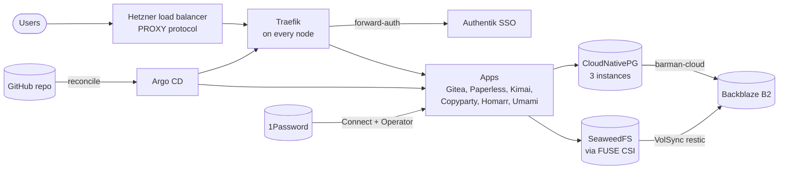

# K3s Service Cluster

A production-style, three-node HA Kubernetes cluster that runs the services
for a small business (Salish Sea Wolf LLC): source hosting and CI, single
sign-on, document management, time tracking, file sharing, analytics and a
personal site. Everything from the cloud servers to the dashboards is code in
this repository; a merge to `main` is a deploy.

**Stack:** Hetzner Cloud, OpenTofu, Ansible, K3s, Argo CD, Traefik, Authentik,
cert-manager, CloudNativePG, SeaweedFS, VolSync, 1Password Operator,
Prometheus, Loki, Alloy, Grafana, Gatus, Renovate.

## Highlights

- **GitOps end to end.** OpenTofu builds the servers, network, load balancer,
  firewall and DNS; Ansible runs once to install K3s, 1Password Connect and
  Argo CD; from then on Argo CD reconciles every component from this repo.
  There is no `kubectl apply` step.
- **Gated rollout.** Argo syncs in waves (operators, then databases, then
  storage and identity, then apps). A canary Job must bind and mount a real
  SeaweedFS volume before any app is allowed to start, a rule that came out of
  the incident below.
- **Secrets never in git.** Only `op://` references are committed. The
  1Password Operator projects secrets into the cluster, and a small Ansible
  role creates the few typed Secrets the operator can't.
- **Every route behind SSO.** Traefik sends all web traffic through Authentik
  forward-auth, except routes that are public by design (the personal site,
  share links, analytics tracking and the login page itself). Token-based
  exceptions (git over HTTPS, APIs) are limited by client IP, which Traefik
  sees because the load balancer speaks PROXY protocol.
- **Defence in depth.** Pod Security Admission `restricted` by default,
  default-deny ingress NetworkPolicies in every namespace, etcd encryption at
  rest, and a node firewall in addition to the cloud firewall.
- **Backups with blast-radius limits.** Postgres (CloudNativePG, three
  instances) backs up daily to Backblaze B2 through barman-cloud; app volumes
  back up hourly with VolSync and restic. Each volume has its own B2 key,
  scoped to its own prefix, so one leaked key exposes one service's backups.
- **Observability as code.** Prometheus alerts (opt-in email per rule), Loki
  logs shipped by Alloy with per-format log-level parsing, Grafana dashboards
  provisioned from ConfigMaps, and Gatus health checks for every service,
  with a Slack alert if Prometheus or Alertmanager themselves go down.
- **Validated before merge.** CI renders every Helm chart and checks the
  output with kubeconform and kube-linter, validates OpenTofu and Ansible, and
  scans the full history with gitleaks. Renovate opens dependency PRs.

## Architecture



Argo CD sync waves:

| Wave | Components | Gate before the next wave |
|---|---|---|
| 0 | Argo CD itself, CRDs, CNPG operator | operators healthy |
| 10 | cert-manager config, step-ca, Postgres, Redis | Postgres cluster healthy |
| 20 | SeaweedFS, Authentik | filer and Authentik up |
| 30 | SeaweedFS CSI, VolSync | PVC canary mounts a real volume |
| 40 | every app under `services/*/app` | none |

## Repository layout

```
infrastructure/tofu/   OpenTofu: servers, private network, load balancer,
                       firewall, Cloudflare DNS
bootstrap/ansible/     one-time: K3s, 1Password Connect + Operator,
                       typed secrets, Argo CD
platform/              cluster-wide services: Argo CD, cert-manager, step-ca,
                       SeaweedFS + CSI, VolSync, monitoring CRDs
services/*/app/        one Helm chart per app, discovered by an ApplicationSet
scripts/               chart render + lint pipeline (used locally and in CI)
docs/                  runbooks, recovery procedure, incident review
```

## Documentation

| Document | What it covers |
|---|---|
| [RCA: SeaweedFS never stored app data](docs/RCA-2026-10-SEAWEEDFS.md) | Two hidden defects left every app volume on node-local disk for three months; how it was found, recovered and prevented |
| [Disaster recovery runbook](docs/RECOVERY-RUNBOOK.md) | Rebuilding the cluster and restoring Postgres and volumes from B2 |
| [GitOps runbook](docs/RUNBOOK-GITOPS.md) | Vault checklist, fresh deploy, day-2 operations, backup keys |
| [Service anatomy](docs/MIGRATION.md) | What every app chart contains, and how services were moved to GitOps |
| [Argo CD SSO](docs/ARGOCD-AUTHENTIK-SSO.md) | Authentik OIDC for Argo CD, and CLI login with API tokens |
| [AGENT.md](AGENT.md) | Ground rules and the gated deploy procedure for AI agents working in this repo |
| [Open work](docs/todo.md) | Known follow-ups |

## Working with AI agents

Much of this repository was built and is operated together with AI coding
agents. [AGENT.md](AGENT.md) is their contract: secrets never reach disk or
logs, the network perimeter is never widened without a human, destructive
operations wait for explicit approval, retries must be idempotent, and git is
the only deploy path. A fresh deployment is a staged procedure with a
verification gate after each stage and an honest partial report as an
acceptable outcome.

## Quick start

Prerequisites: [mise](https://mise.jdx.dev/), the
[1Password CLI](https://developer.1password.com/docs/cli/) signed in with
access to the `K3s Service Cluster` and `Hermes Agent` vaults, and a
Cloudflare DNS API token in the vault.

```bash
mise install
mise run setup        # tofu init + Ansible collections
mise run check        # yamllint, tofu validate, ansible-lint, render + lint every chart
mise run bootstrap    # tofu apply, K3s, 1Password Connect, Argo CD
kubectl -n argocd get applications -w    # watch the waves converge
```

Day to day: open a PR, let CI validate it, merge, and Argo CD converges. See
the [GitOps runbook](docs/RUNBOOK-GITOPS.md) for adding services, rotating
secrets and creating backup keys.
